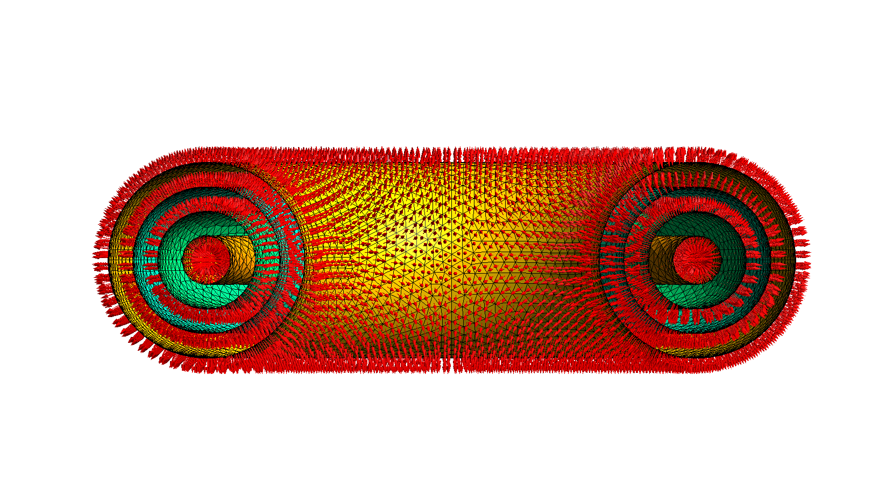

# Summary

Neutron–material interactions are a central area of study in nuclear science and engineering.
As neutrons interact with the surrounding materials, they undergo a number of nuclear reactions.
These interactions are often studied using Monte Carlo simulation methods.
Stellarmesh is an MIT-licensed Python library that preprocesses, meshes, and converts CAD geometries into a format suitable for analysis with the open-source particle transport code OpenMC [@romano2015] and the Direct Accelerated Geometry Monte Carlo (DAGMC) CAD-transport extension [@wilson2010].

# Statement of Need

The development of Stellarmesh is motivated by the increase in demand for an open-source neutronics software ecosystem, the need to perform analysis on complex CAD geometries, and the unique mesh requirements imposed by the DAGMC mesh transport library.

## Open-Source Neutronics

In recent years, open-source tools for neutronics have gained traction within academia and private industry [@peterson2024].
This interest is due in part to export-control restrictions [@lanl_mcnp_access] that limit access to traditional transport codes such as MCNP [@kulesza2022].
These free-software alternatives---which include the Monte Carlo transport code OpenMC [@romano2015], the mesh-based particle tracking library DAGMC [@wilson2010], the parametric CAD libraries CadQuery [@cadquery] and build123d [@build123d], and the mesh generator Gmsh [@geuzaine2009]---form a growing ecosystem of open-source libraries that compose flexibly in standard Python environments.

## CAD Geometry

Monte Carlo neutron transport codes traditionally use constructive solid geometry (CSG) to represent experiment geometry [@romano2015; @shriwise2022].
This is suitable for simple geometries.
However, most complex models are developed using boundary-representation computer-aided design (CAD) software.
These models can then be discretized into surface or volume meshes using a variety of meshing codes.
While approaches such as GEOUNED [@catalan2024] exist to translate boundary representation models to CSG, the spline surfaces common in these models must ultimately be discretized in either case [@catalan2024; @haussler2017].

DAGMC [@wilson2010] is a library that enables ray-traced queries on triangular surface meshes derived from CAD geometry, and which can be used in conjunction with OpenMC to support transport on such meshes [@openmc_docs_cad].

## DAGMC Mesh Requirements

DAGMC meshes are stored in the HDF5-based format of the Mesh-Oriented datABase (MOAB) [@moab; @moab_readme] and comprise a set of closed logical volumes bounded by surface meshes, for which \autoref{fig:dagmc-attributes} shows a visual representation. These meshes must adhere to the following requirements [@smith2010; @dagmc_docs]:

- **Orientability:** The normals of every triangle on a surface must point toward the same volume.
- **Shared-surface topology:** Where adjoining volumes touch, they must share a single surface at the point of intersection. Each surface must label which logical volume the triangle normals point into and which they point out of.
- **Non-intersection:** Surface meshes must not intersect themselves or other meshes.
- **Watertightness:** While meshes with at least one shared surface are inherently non-manifold, the set of surfaces bounding a volume must not contain holes or open edges.

DAGMC does not mesh geometries itself.
As a result, a separate library is required to convert CAD geometries to DAGMC meshes with correct metadata.

{#fig:dagmc-attributes}

# State of the Field

DAGMC was first released as a MOAB tool in 2007 [@moab_3_0].
At this time, it supported only geometries from the proprietary ACIS geometry kernel, and these models were meshed at runtime using the bundled ACIS faceting routines [@moab_3_0; @cnerg_using_dagmc_2010].
In 2010, faceting became a preprocessing step [@moab_dagmc_preproc] and watertight-sealing methods were published [@smith2010].

As of 2014, a typical DAGMC workflow relied on the proprietary meshing library Cubit [@cubit; @coreform_rebrand] and resembled the following [@dagmc_uwuw_2014]:

1. Import, imprint, and merge geometry using Cubit
2. Assign volumes to material groups in Cubit
3. Export the Cubit model in ACIS format
4. Facet it with `dagmc_preproc`
5. Seal the result with `make_watertight`

In 2016, the developers of DAGMC added an `export_dagmc` command to the Svalinn Cubit plugin, enabling users to perform steps 3 through 5 from within Cubit [@svalinn_cubit_plugin][^cubitnative].

[^cubitnative]: In 2023, Coreform added native DAGMC export to Cubit [@coreform_cubit_2023_11], and the Svalinn plugin has been unsupported since June 2025 [@svalinn_cubit_plugin].

In 2018, the first fully open-source alternative workflow was enabled with the development of `occ_faceter` [@occ_faceter], a C++ library that meshed geometries from the open-source OpenCASCADE (OCC) geometry kernel and converted them to DAGMC format.
However, no packaged release of the project was ever made.

The first packaged Python DAGMC export came as part of the 0.0.12 release of Paramak---an OCC-based tokamak modeling library---in September 2020 [@shimwell2021; @paramak_pypi].
Paramak exported its own reactor objects as H5M either through Cubit or through direct STL export and conversion.
These two export methods were later extracted from Paramak in 2021 and repackaged as `cad_to_h5m` [@cad_to_h5m] and `stl_to_h5m` [@stl_to_h5m] respectively.
However, `cad_to_h5m` still had a dependency on Cubit and `stl_to_h5m` did not support shared-surface topology.

In 2022, two further libraries, `brep_to_h5m` [@brep_to_h5m] and `vertices_to_h5m` [@vertices_to_h5m], were released.
`brep_to_h5m` meshed OpenCASCADE BREP files with Gmsh and exported them to H5M with `stl_to_h5m` and later with `vertices_to_h5m`, which allowed the creation of H5M files from vertices stored in-memory.

The first general-purpose, open-source converters came later in 2022 with the release of CAD-to-OpenMC [@cad_to_openmc] and CAD-to-DAGMC [@cad_to_dagmc].
These libraries were the first to take arbitrary CAD geometries from OpenCASCADE, imprint and merge them, and convert them to tagged H5M models.
However, until late 2023, neither tool supported shared-surface topology [@cad_to_dagmc_v050; @cad_to_openmc_v026].

In September 2023, the authors released the first version of Stellarmesh.
Its development was motivated by the fragmentation of existing libraries and the lack of any self-contained converter library that wrote all required DAGMC metadata.
Stellarmesh aims to be feature-complete, stable, documented, and correct.

Since then, Cubit, CAD-to-OpenMC, CAD-to-DAGMC, and Stellarmesh have each matured with active maintenance and new feature releases.
Thus, at this time, there are four actively maintained libraries for DAGMC mesh preparation. \autoref{tab:comparison} compares them on a subset of desired attributes including license, geometry input support, meshing backends, and testing methodology.

: Comparison of Stellarmesh, CAD-to-DAGMC [@cad_to_dagmc], CAD-to-OpenMC [@cad_to_openmc], and Coreform Cubit [@cubit] on a subset of features. \label{tab:comparison}

| **Feature**                         | **Stellarmesh**                                         | **CAD-to-DAGMC**                                                        | **CAD-to-OpenMC**                                                       | **Coreform Cubit**                                   |
| ----------------------------------- | ------------------------------------------------------- | ----------------------------------------------------------------------- | ----------------------------------------------------------------------- | ---------------------------------------------------- |
| **License**                         | MIT                                                     | MIT [^c2dlicence]                            | MIT                                                                     | Proprietary; export-controlled (EAR99) [@coreform_export]               |
| **Input geometry formats**          | CadQuery or build123d objects, OCC pointers, STEP, BREP | CadQuery objects, STEP                                                  | STEP                                                                    | ACIS, Pro/E, CATIA (native); STEP, IGES (translated) [@coreform_importing] |
| **Surface meshing backends**        | OCC and Gmsh                                            | Gmsh and `cad-to-dagmc-mesher`                                            | OCC and Gmsh                                                            | Cubit internal                                       |
| **Volume meshing backends**         | Gmsh                                                    | Gmsh and `cad-to-dagmc-mesher`                                            | None                                                                    | Cubit internal                                       |
| **Python environment requirements** | ABI-compatible MOAB and Gmsh                            | CadQuery; MOAB not required                                             | CadQuery; MOAB                                                          | Installed Cubit application + license                |
| **Surface boundary conditions**     | Yes                                                     | No                                                                      | No                                                                      | Yes                                                  |
| **Release cadence**                 | 11 releases, 2023-09 to 2026-02                         | 58 releases, 2022-08 to 2026-10; no stable release                      | 26 releases, 2022-07 to 2025-02                                         | About 3 per year [@coreform_release_notes]                                     |
| **Testing**                         | CAD-vs-CSG benchmarks                                   | CAD-vs-CSG benchmarks from `model_benchmark_zoo` [@model_benchmark_zoo] | CAD-vs-CSG benchmarks from `model_benchmark_zoo` [@model_benchmark_zoo] | Undetermined                                         |

[^c2dlicence]: At the time of writing, the source code for the most recent version of `cad-to-dagmc-mesher`, (0.3.7), is not public [@cad_to_dagmc_mesher]. Its public source stops at version 0.3.2.

# Software Design

## Geometry Kernel

Boundary representation geometry operations are performed by the OpenCASCADE (OCC) [@occt; @ocp] geometry kernel.
OCC provides STEP file import [@occt] and is the geometry kernel underlying CadQuery [@cadquery] and build123d [@build123d], so Stellarmesh can process their objects directly.
Stellarmesh additionally exposes OCC's imprint-and-merge functionality [@occt] to create shared-surface topology.

## Meshing Backend

Stellarmesh provides two meshing backends.
For each, a subset of useful options is exposed for mesh control.

The OCC backend uses OpenCASCADE's built-in meshing functionality to produce surface meshes.
This backend supports linear and angular deviation tolerances [@occt], which can be used to ensure that volumes separated by a known distance do not overlap.

The Gmsh [@geuzaine2009] backend does not support these tolerances, but in contrast to the OCC backend---whose meshes are primarily tailored to visualization---its algorithms are optimized to produce high-quality triangle elements with lower aspect ratios [@gmsh_manual].
In addition, Gmsh can generate tetrahedral volume meshes that Stellarmesh converts to MOAB format [@moab] for unstructured volume-mesh tallies in OpenMC [@romano2015].

## Stable File Format

Regardless of the meshing backend, all Stellarmesh meshes are stored in Gmsh MSH 4.1 format [@gmsh_manual], with metadata encoded in Gmsh physical group names as URL-style `key=value` strings.

Because this metadata format is stable and documented, anyone can create a custom mesh backend for Stellarmesh.
For example, Basalt [@basalt] is a mesh backend for Stellarmesh developed by the authors that meshes proprietary Parasolid [@parasolid] geometries from commercial CAD software.
Stellarmesh then provides the DAGMC file creation and metadata tagging, allowing for simple substitution of geometry sources.

## Testing and Verification

The Stellarmesh repository runs continuous integration tests on each commit.
These tests perform Monte Carlo transport on a selection of CSG and Stellarmesh models of the same geometries to assert that the results match to within a fixed relative tolerance of 2.5%.

## Workflow

\autoref{fig:workflow} shows a symbolic representation of a typical end-to-end neutronics workflow using Stellarmesh.
In this example, a stellarator equilibrium model is loaded using DESC [@dudt2020; @panici2023; @conlin2023; @dudt2023].
From the DESC equilibrium, the blanket geometry is modeled with build123d.
The geometry is imported into Stellarmesh, and a DAGMC surface mesh is generated.
This surface mesh is then used for transport in OpenMC.

![An example neutronics workflow. A stellarator equilibrium is loaded using DESC [@dudt2020]. The blanket CAD geometry is built from this equilibrium using build123d. The DAGMC surface mesh is generated using Stellarmesh. Transport is performed using OpenMC.](workflow.png){#fig:workflow}

# Research Impact Statement

Stellarmesh models have been used in five peer-reviewed journal publications.
All CAD neutronics models for Thea Energy's initial conceptual publication in *Nuclear Fusion* [@gates2025] and for the Helios Stellarator Design special issue of *Fusion Engineering and Design* [@swanson2026overview; @pasmann2026] were developed with Stellarmesh.
\autoref{fig:tally} shows an OpenMC heating tally performed on a Stellarmesh model. The figure is reproduced from Fig. 15 of @pasmann2026.

Stellarmesh has additionally been used in the development of material volume fraction estimation [@romano2025] and shutdown dose rate analysis [@romano2027] in OpenMC.

{#fig:tally}

# AI Usage Disclosure

Stellarmesh versions up to v1.0.0 (September 2025) were designed and written without generative-AI assistance.
Since v1.0.0, the developers have used Google and Anthropic models for code assistance and documentation.
All model output has been verified.

# Acknowledgments

Development of Stellarmesh is funded by Thea Energy.
Koen, Pasmann, and Romano are employed by Thea Energy.

# References
